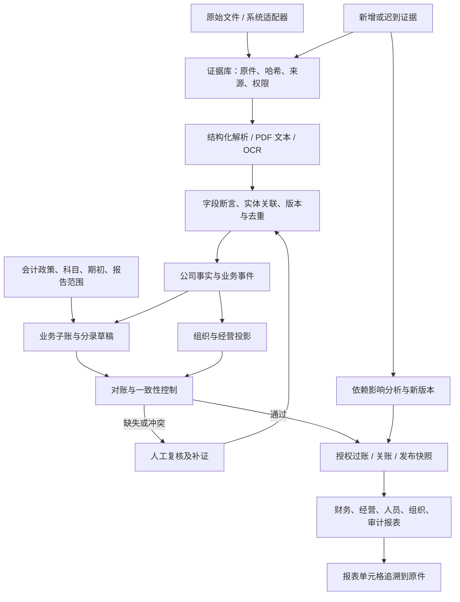

# Evidence → 公司事实 → 账本 → 全套报表：工程规划 v1

日期：2026-10-29。状态：待讨论的工程设计，尚未实施。

本版依据本地公司包、根目录 `mermaid-diagram.png`、扩展包的 `governance/business_workflow.svg`、现有架构文档及部分核心代码制定。数据规模引用包内统计，未重新执行包内验证或真实 OCR。目标是实现这套模拟公司覆盖的全流程，而非宣称覆盖所有行业及法定报表。

## 1. 建议与工程边界

建议在现有 QFR 上增加一个共享的 Evidence-to-Reports 内核：原件不可变、事实可修订、业务事件可追踪、账本确定性计算、报表按版本发布。复用现有前端的对账、审核和追溯交互，将原本分散的数据流接到同一个服务端事实库与账本。

核心原则：**一个经济事件只记账一次，同一事件可以有多份证据；所有报表使用同一版本的事实、账本和政策。** AI 负责抽取、候选关系和分类建议；金额运算、结算分配、会计过账、关账和权限由确定性程序控制。

首期采用文件包作为数据源；未来 Xero、QuickBooks 使用适配器接入同一模型。源系统已有总账与从原件重建的账本应作为不同账本进行比较，不能相加。

本期包括财务、经营、人员、组织及审核报表；不实施真实付款、税务申报或外部系统写回。模拟税费、工资及库存规则来自公司包政策，不作为真实公司的法定政策。

## 2. 已有材料与基线选择

| 材料 | 已观察到的内容 | 在工程中的用途 |
|---|---|---|
| `outputs/company-mock-data-2026-q3/` | 早期季度包 | 保留为独立历史样本，不混入年度账本 |
| `outputs/company-operations-mock-2025-10-to-2026-09/` | 单法人年度运营；300 张订单、499 条银行流水、270 份工资记录；答案包含 4,320 行分录 | 第一阶段年度闭环与回归样本 |
| `outputs/company-operations-expanded-v2-2026-10-to-2027-09/` | 接续前一年度；38 张源表、5,973 行结构化资料、312 张订单、597 条流水、290 个工资单版本；75 个场景 | 主目标数据集；覆盖采购、项目、多法人、版本与复杂对账 |
| v2 `03_document_challenges/` | 72 份挑战 PDF，其中 36 份纯栅格 PDF | 独立文档识别验收，不计作新增交易 |
| 根目录流程图 | 接入、识别、关联、事实、账务、检查、审核发布及增量回流 | 本方案的业务主线 |
| 包内工作流 SVG | 订单/合同→收货验收→交付/里程碑→开票结算；工资、关账旁路 | 事件状态与业务触发依据 |

年度衔接必须明确：2025–2026 年度与早期季度包独立；v2 接续年度包期末，旧年度损益结转留存收益。允许“独立启动 v2，使用其期初资料”和“连续运行两年度”两种模式，但每次只能选择一个期初来源。

v2 还提供 `effective_at`、`recorded_at` 和组织关系生效区间，已有足够材料验证双时间模型。期末为 2027-09-30；知识截止分别为 2027-10-03 与 2027-10-15 的两个版本须保持可复现。这些日期是模拟业务日期。

## 3. 当前 QFR 能复用什么，缺什么

| 现有部分 | 可复用 | 需要补足 |
|---|---|---|
| `frontend/src/lib/data-intake.ts` 与导入页 | 格式校验、金额和日期处理、原件/行号保留 | 当前主要是分类汇总；需要公司包适配、多表关系、后台批处理 |
| Reconciliation 流程 | 独立抽取、候选匹配、异常复核、金额阈值 | 通用银行格式、多对多分配、退款拒付及统一结算账本 |
| `frontend/src/lib/payroll-ledger.ts` | 整数分、计提与支付分离、防重复和部分付款思路 | 当前绑定演示公司与科目；需通用规则、法人和更正版本 |
| `frontend/src/lib/trace-model.ts` / Report Explorer | 从报表聚合数下钻、原件预览 | 完整字段→事实→事件→分录→报表单元格的血缘 |
| `frontend/src/lib/report-source.ts` | 数据源切换 | 增加公司、账本、期间、知识截止与发布版本维度 |
| Python Xero/QuickBooks 管线 | 数据获取、映射验证、报表与差异分析 | 统一规范化接口，区别外部总账与原件重建账本 |
| 浏览器 IndexedDB 审核存储 | 演示交互、历史草稿导出 | 服务端持久化、真实角色、并发控制、备份与审计 |

当前 README 明确说明：导入汇总不是完整财务报表；对账不会自动过账；浏览器审核未同步 Python。工程首要工作是补齐这些连接，而不只是增加报表页面。本版未做全仓代码审计。

## 4. 目标链路与模块



| 模块 | 输入与职责 | 输出及关口 |
|---|---|---|
| Evidence intake | 目录或上传导入；检查 manifest；保存原件、来源和批次 | 可定位原件；异常文件隔离，失败可重试 |
| Extraction | CSV 按显式 schema；PDF 先读文本，无文本再 OCR；邮件/聊天拆出断言 | 字段原值、规范值、来源定位、模型/解析器版本；无证据留空 |
| Entity resolution | 法人、往来单位、员工、科目、商品、项目；别名与生效区间 | 稳定实体 ID；冲突候选进入审核 |
| Fact/event engine | 组合合同、订单、收货、交付、发票、工资及银行信息 | 业务状态与事实版本；区分观测、推断、人工确认 |
| Subledgers/posting | 应收应付、库存、工资、资产、项目；按政策产生平衡分录 | 待审分录、已过账分录、冲销/更正关联 |
| Controls/review | 校验、分配、证据缺失、权限与期间控制 | 有责任人和处置记录的异常队列 |
| Reporting/publishing | 从已确认事实与已过账账本生成数据集，控制发布版本 | 同一快照的页面、CSV/XLSX/PDF、审计包 |

不要要求所有证据都进入总账。部门改名、订单取消、审批驳回等应更新业务或组织状态，只有满足规则的经济事件才生成分录。

## 5. 数据模型与约束

建议第一版使用关系数据库，关系边也存为表；暂不引入独立图数据库。金额统一为整数最小货币单位，数量/单价使用显式精度，API 金额避免 JavaScript 安全整数溢出。

| 对象 | 最低必要字段 |
|---|---|
| `dataset` / `import_batch` | 数据集、法人范围、来源、运行模式、批次、schema 版本 |
| `evidence_document` | 文件 ID、SHA-256、对象存储位置、格式、原始路径、业务文档 ID、版本、访问等级 |
| `extraction_run` / `field_assertion` | 解析器/模型/提示词版本、字段原值与规范值、置信信息、页码+bbox 或表行列/文本位置 |
| `entity` / `relationship` | 法人/员工/客户等类型、源 ID、别名、关系类型、有效起止、证据 |
| `business_event` / `event_evidence` | 事件类型、经济交易 ID、状态、业务日期、源记录时间、系统接收时间、证据关联 |
| `settlement_allocation` | 银行记录、被结算项目、分配金额、手续费/退款分类、状态与证据 |
| `journal_entry` / `journal_line` | 法人、账本、日期、科目、借贷分、项目/部门、事件、政策版本、冲销对象 |
| `review_case` / `review_decision` | 异常码、重要性、候选、责任角色、决定、理由、证据、修订号、实际操作者 |
| `report_snapshot` / `report_cell_lineage` | 法人或集团、期间、知识截止、政策/映射/代码版本、账本水位、单元格依赖 |

必须落实的约束：

1. 文件去重与交易去重分开：相同文件哈希可复用存储；CSV/PDF/扫描件归属同一经济交易时不能重复过账。模糊相似度只能建议合并。
2. 所有业务唯一键包含数据集/法人/来源；同编号跨法人不合并，共享供应商也保留不同法人余额。
3. 过账幂等键包含法人、经济事件、事件版本和过账类型，并以数据库唯一约束保护；不能仅靠前端按钮禁用。
4. 已过账分录不可原地改写；更正采用冲销重记或有依据的差额分录。规则升级不能给旧事件额外再记一次账。
5. 保留 `effective_at`、`source_recorded_at`、`ingested_at`。模拟知识截止使用源记录时间，实际审计保留系统接收时间；没有可靠记录时间的证据标明未知。
6. 原件、模型建议、人审修订分层存储；原件不覆盖，审批不等于付款，识别置信分数不等于会计正确率。
7. 对账分配支持多对多并锁定余额；事务内检查分配总和、货币、可结算余额，防止并发超额分配。
8. 缺失到期日保持未知，不能自动填月末后生成虚假账龄；缺失证据定位不能生成虚假高亮。

## 6. 各业务闭环与核心规则

| 闭环 | 事件链 | 必须验证的处理 |
|---|---|---|
| 销售到收款 | 合同/订单→交付或验收→发票→收款分配 | 按包内政策识别收入；预收为负债；分批交付、贷项、退款分别记录 |
| 采购到付款 | PO→审批→收货/质检→GRNI→账单→贷项→付款 | 拒收不入可用库存；账单清理 GRNI；标准成本与采购价差分离 |
| 库存 | 期初→入库→调拨→销售/项目领料→损坏 | 双仓调拨公司总量不变；数量及价值可滚动核对；不允许无依据负库存 |
| 工资 | 员工状态/工时→工资版本→审核→计提→批次支付→银行 | V2 替代 V1，只记更正差额；失败支付不减少现金；项目分配不重复记费用 |
| 项目 | 合同→工单→工时/材料→里程碑验收→收入成本 | 验收证据控制收入；人工分摊追到工资；预算与实际分开 |
| 资金 | 流水→付款尝试/汇款通知→分配→对账 | 一付多票、多付一票、第三方授权；重复付款保留客户信用；拒付重开应收 |
| 月结 | 期初→日常分录→计提/预付摊销/折旧/减值→控制→发布 | 计提冲回与真实账单避免双计；非现金项目不进入现金流 |
| 组织与集团 | 法人/部门/员工→关系变动→历史快照→合并 | 部门不当成子公司；法人先独立出账，再在合并层抵销 |

用具体案例作为开发验收入口：`S2-2026-10-001` 分批交付、`P2-2026-10-1` 部分收货与价差、`RC-BUNDLE` 多票收款、`RC-UNKNOWN` 保留两个候选、`PR-2027-08-EMP-009-V2` 工资更正、`PROJECT-01-M1` 验收、`LATE-INVOICE` 迟到发票。

付款只表示已观察到的模拟结算状态，本工程不发起银行付款。无法归属的银行流水应作为待核项目显示；如政策允许进入暂记科目，必须有明确规则和待清余额，不能将其猜为收入。

## 7. “所有报表”的交付清单

| 类别 | 本期报表 | 计算基础 / 追溯入口 |
|---|---|---|
| 核心财务 | 利润表、资产负债表、现金流量表、试算平衡表、总账及科目明细 | 已过账分录、期初、现金交易分类；单元格→分录→事件→原件 |
| 往来资金 | AR/AP 账龄、未结项目、客户信用/押金、银行对账、付款及退款状态 | 项目余额与有效分配；未知到期日单列 |
| 库存采购 | SKU/仓库数量价值、库存变动、收货未开票、采购差异、退货损坏 | 库存及采购事件；与控制科目核对 |
| 工资人员 | 工资汇总/明细、未付工资与其他工资负债、付款对账、人数/FTE、入离职 | 工资版本、员工有效日期、已确认结算 |
| 经营项目 | 销售交付/积压、客户变化、项目收入成本毛利、预算差异、部门成本 | 业务事件与成本分配；不把订单金额当已确认收入 |
| 公司结构 | 法人关系图、组织架构、汇报线、职责/审批关系、业务流程及状态 | 有生效日期的关系和政策；图中节点/边能打开证据 |
| 集团与版本 | MFS/MNL 单体、集团汇总与抵销、关账版本、重述差异桥 | 单体账本+合并调整层；旧发布快照不变 |
| 证据审核 | 文件覆盖率、缺失/冲突清单、未分配流水、审核轨迹、报表证据包 | 来源覆盖矩阵、控制结果、实际审核决定 |

现金流第一版优先用银行及现金事件构建直接法，并与现金期初/期末核对。间接法作为后续扩展，不能把利润简单当成现金流。

各报表注册 `report_definition`：明确维度、计算公式、科目映射、期间/截止规则、依赖和校验项。部门及项目没有可靠分配依据的金额显示“未分配”，不靠 AI 猜测摊平。

公司流程图分为政策规定流程和事实观察到的执行流程；审批历史显示偏离规定之处。流程图本身不是一笔交易已执行的证据。

## 8. 审核、关账与增量更新

将状态分为四类，避免用一个“Approved”混合所有动作：

- 识别：queued → extracted → validated / needs_review。
- 业务审核：proposed → confirmed / rejected / superseded。
- 会计：draft → approved → posted → reversed。
- 报表：draft → validated → approved → published → superseded（保留旧版本）。

证据冲突、法人不明、重复事件、借贷不平、超额分配、权限不符属于硬阻断；已识别但缺少签收等事项按政策与金额决定阻断相关过账还是披露为开放事项。每个控制须声明阻断范围，不能默默删除问题交易后把报告标为完整。

审核页需要：左右对照原件与提取字段、候选交易、分录影响预览、影响报表、修改理由、复核角色和版本冲突提示。当前自报 reviewer/manager 不能作为服务端权限依据。

发布快照固定：法人范围、期间、知识截止、原件/事实/账本版本、政策与报表定义、审核决定。集团报表同时固定各单体快照和抵销版本。

新证据到达后，沿依赖图标记受影响事实、事件、账务及报表为待重算；未受影响的抽取结果复用。新证据推翻原审批依据时，旧批准不直接继承。已关账期间触发重开或调整政策，生成新版本及差异桥，禁止覆盖旧发布结果。

## 9. 技术实施与接口建议

建议沿用 Python 处理数据、Next.js 展示交互，新增单一后端业务服务和异步 worker。服务端 PostgreSQL 保存业务、分录和审核；原件存对象存储，本地开发使用统一文件存储接口。第一阶段可用数据库任务表运行 worker，无需先拆微服务或建设独立图平台。

任务粒度为文件或业务对象；每个阶段保存输入哈希、版本、状态、错误和重试次数。OCR/模型调用有并发、时限和预算限制，失败文件可单独重跑。前端进度取真实任务结果，不使用模拟完成动画。

建议目录（新增，而非本次已创建）：

```text
backend/evidence/        原件与抽取
backend/adapters/        annual_pack、expanded_pack、未来外部源
backend/domain/          事实、实体、事件、子账
backend/accounting/      政策、分录、结算与关账
backend/controls/        一致性、审核、发布门槛
backend/reporting/       报表定义、快照、血缘与导出
backend/api/             UI 接口与授权
backend/jobs/            后台任务与增量影响
evaluation/              隔离的答案比较与 OCR 评估
tests/fixtures/          最小原始输入场景
```

最低接口契约：

| 接口 | 用途 |
|---|---|
| `POST /datasets/{id}/imports` | 创建导入任务，返回 job_id；校验输入白名单 |
| `GET /jobs/{id}` | 真实阶段、成功/失败/待审数与错误 |
| `GET /evidence/{id}` | 按权限取原件及提取版本 |
| `GET /events/{id}` | 业务链、证据、候选分录与状态 |
| `POST /reviews/{id}/decisions` | 携带 expected_revision，拒绝过期决定 |
| `POST /journals/{id}/post` | 权限、期间、控制和幂等检查后原子过账 |
| `POST /report-snapshots` | 指定法人、期间、知识截止及规则版本生成草稿 |
| `POST /report-snapshots/{id}/publish` | 通过发布门槛后冻结快照 |
| `GET /report-snapshots/{id}/cells/{cell}/lineage` | 返回公式、分录/事实及证据位置 |

所有写入携带幂等标识，关键更新支持修订冲突返回。服务端按租户/法人授权；工资原件单独限权；备份恢复、审计记录和外部模型调用数据最小化纳入集成阶段。

## 10. 分阶段交付与依赖

以下是工作量估算，不是交付承诺。按 1 名熟悉现有仓库的全栈工程师、财务规则负责人每周参加验收估算，总体约 11–16 工程周；文档识别长尾、现有接口重构和规则歧义可能扩大范围。

| 阶段 | 预计 | 可演示交付 | 验收出口 |
|---|---|---|---|
| P0：契约与证据清单 | 1 周 | 包版本与输入白名单、报表目录、政策矩阵、最小案例、schema | 每张源表对应适配器/事件；未知项记录；答案隔离 |
| P1：最小纵向闭环 | 2 周 | 期初+一笔销售/交付/收款→平衡分录→TB/P&L/BS/现金变动→原件追溯 | 重传不重复；单元格可追溯；待审不伪装完成 |
| P2：基础年度全量 | 2–3 周 | 全年度销售、采购、库存、工资、资产与月结；账龄/对账 | 单体报表及子账与控制科目一致；通过基础包回归 |
| P3：文档识别与审核集成 | 2–3 周 | PDF/扫描件/邮件、字段定位、复核修改、服务端持久化及角色 | 隔离 OCR 评估；无法识别能拒答；纠正后链路重算 |
| P4：扩展年度复杂业务 | 3–4 周 | 项目、多仓、更正、组织变更、MNL/合并、V1/V2 与差异桥 | v2 场景逐条通过；迟到资料不污染 V1 |
| P5：发布与可靠性 | 1–3 周 | 统一导航、所有范围内报表导出、发布版本、备份恢复及权限验收 | 端到端演示、故障恢复、并发/越权/重跑检查 |

P0 的冻结契约先于其余阶段；P1 的统一账本先于全量报表。P3 的小样本识别试验可提前，但不能用 OCR 输出不稳定作为跳过账务验证的理由。

第一轮迭代具体工作项：

1. 登记 annual-v1、expanded-v2、ocr-challenge 三个隔离数据集，保留独立账本和运行模式。
2. 建立文件/字段证据模型、业务日期与记录日期模型、金额类型。
3. 实现科目、法人、期初、销售、交付、银行与分配的首组适配器。
4. 实现确定性分录与交易级约束，输出第一份 TB/P&L/BS。
5. 报表追溯页新增“公司重建”来源，展示一个数字的完整链路。
6. 加入重复文件、无签收、同金额双候选、失败支付四个负向案例。

## 11. 验收设计与防止答案泄漏

分三种运行模式，结果分别报告：

- **结构化重建**：仅原始源表和必要政策/原件输入，验证业务和计算。源表已有付款分配或审核提示可使用，但记录为“来源提供”，不能算成系统独立推断成功。
- **文档识别**：仅独立挑战 inputs 和允许的 statement；不提供同一经济文档的干净副本、结构化答案或金标准坐标。statement 不作为发票金额抽取目标。
- **混合实务**：使用公司原始资料整体，由多证据融合完成重建；仍与 OCR 盲测成绩分开。

生产管线按路径与角色白名单读取；`02_ground_truth_DO_NOT_IMPORT/`、生成脚本、中间生成状态和验证输出不进入抽取上下文。评估器使用独立入口与权限，在生成结果落盘后才读取答案。已读过的包与场景是开发回归集，不能宣称完全未见过的最终盲测；正式准确率还需新增保留集。

| 验收面 | 建议门槛 |
|---|---|
| 导入完整性 | 白名单文件均有成功、失败、重复或人工隔离结果；禁止静默丢弃 |
| 确定性账务 | 每笔借贷相等；金额以分核对，差异为 0；差异不能用平衡项补齐 |
| 财务勾稽 | 银行↔现金总账、AR/AP↔控制科目、库存↔存货、工资↔负债、现金流↔期末现金 |
| 年度衔接 | 上年度期末与下年度期初按结转规则衔接，不重复带入期初及历史收益 |
| 场景覆盖 | 75 个场景逐条列明通过/失败/待人工；重点异常必须保留或正确处置 |
| 幂等与修订 | 重传、重试、并发确认不重复过账/分配；工资替代与冲销可重放 |
| 发布版本 | 相同输入与规则重放相同结果；V1 不含迟到资料；V2 差异有证据 |
| 追溯 | 发布金额均有分录或明确公式；叶子依赖可追到原件/期初，缺证有标记 |
| OCR 与实体关联 | 分字段准确率、自动接受精度、覆盖率、拒答率和人工修订率；不只报一个总准确率 |
| 安全及可靠性 | 角色/法人/工资隔离，冲突写入拒绝，备份恢复，worker 中断重跑 |

OCR 数值阈值在小样本基线后制定，v1 不预先承诺“99%”。已知缺页、遮挡、日期歧义样本的正确行为可能是请求人工审核。重点防范错误自动接受，保留人工审核率和每文档费用/耗时。

分录验证按业务语义、科目、期间和金额比较，不要求新系统生成的 journal ID 或拆行方式与答案完全相同。答案存在口径错误时记录差异与依据，不修改引擎去迎合错误答案。

## 12. 第一版需要锁定的决策与主要风险

默认建议：以基础年度为第一闭环，以 expanded-v2 为完整验收目标；服务端共享账本；结构化优先，OCR 单独评价；全套输出使用同一版本快照；集团能力在单体稳定后接入。

主要风险及处理：

- 原始资料包含人工做好的分配/审核提示，会夸大推断能力：按来源辅助与独立推断分别评分。
- 文件包内部校验通过不代表引擎重建成功：本项目重新实现并验收，不能直接展示答案作为成果。
- “全部报表”持续扩大：以第 7 节登记清单为 v1 范围，新增报表须补公式、来源和验收样例。
- 管理口径、财务政策或跨法人关系含歧义：先形成可复核的政策配置与例外队列，不用 AI 默认补齐。
- 现有前端多个存储与计算来源造成漂移：逐页切换到快照 API，在迁移期间明确显示来源和版本。
- 晚到资料和规则升级改写历史：从第一阶段保存版本及依赖，后续发布不可覆盖。

最终演示应从一个空数据集开始：导入原始公司包，查看真实进度和异常，完成必要审核，生成并发布整套报表；从任一金额回到原件；补入迟到资料后生成 V2，仍可打开 V1 并解释每一笔差异。
